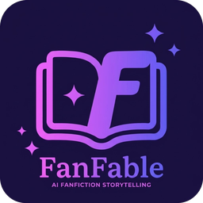

# FanFable

FanFable is a local AI writing tool for creating fanfiction and alternate-universe stories based on books you provide. It aims to help AI understand a book's characters, relationships, events, and lore so it can generate new stories without constantly losing track of canon.

Instead of relying on prompts alone, FanFable aims to build a connected understanding of the source material. This can help with story planning, continuity, and exploring new ideas while staying consistent with the original book.

FanFable runs locally using local AI models and a local database, keeping your books and stories on your own machine.

## Research

I'm exploring ways to improve how AI retrieves and understands information from books, especially across long stories.

- **Associative Retrieval:** Connecting related words, names, concepts, and passages so relevant information can be found even when the exact words aren't present.
- **Knowledge Graphs:** Connecting characters, places, events, and facts to build a structured picture of a book's world.
- **Storytelling Harness:** Bringing research, planning, writing, and continuity checking together into one system.
- **LLM Extraction:** Finding better ways to extract accurate information from books while keeping it grounded in the original text.

These ideas are still being researched, and the goal is to find approaches that actually improve the results.

## Development

FanFable is being developed with the help of AI coding tools. I use AI to help write and debug the code, while I guide the project's design, features, and overall direction.

## How FanFable Is Different

There are already AI writing tools that offer story generation, worldbuilding, and lore management. FanFable is being built specifically around fanfiction, with the goal of giving writers more control over how they explore and change existing fictional worlds.

- **More Than Story Generation:** Create entirely new fanfiction stories or explore alternate universes based on books and other source material.
- **Freedom to Change Canon:** A long-term goal is to support changes at any scale, from something small like a character's appearance to major changes that reshape the central plot and the events that follow.
- **Connected Lore Retrieval:** Rather than relying only on keyword searches, FanFable aims to connect characters, concepts, relationships, and events to find relevant information throughout a book.
- **Continuity Across Changes:** Track how changes to canon affect characters, relationships, events, and future chapters, helping keep an alternate storyline consistent with its own established rules.
- **A Complete Writing Workflow:** Bring research, planning, writing, and continuity checking together in one system.
- **Local-First:** Run using local AI models and storage without depending on paid cloud services.

The goal is to give writers the freedom to reshape the stories they love, whether they're creating something entirely new or changing a single detail that sends the original story in a completely different direction.

## Future Plans

- **Smarter Retrieval:** Find relevant information across an entire book, including connections that simple keyword searches might miss.
- **Story Planning:** Develop premises, alternate universes, outlines, and character arcs.
- **Continuity Tracking:** Track character knowledge, relationships, timelines, and ongoing plot threads.
- **Canon Consistency:** Catch contradictions and keep new stories grounded in their source material.
- **More Writing Options:** Expand beyond fanfiction into other forms of creative writing.
- **Local and Accessible:** Keep the tool usable on personal hardware without requiring paid cloud services.

FanFable is still a work in progress, with plenty left to build and improve.

## Final thoughts

I'm open to feedback, constructive criticism, advice, and contributions. I'm especially interested in hearing from people with experience in **LLM information extraction, retrieval systems, knowledge graphs, and long-document processing**.

If you have useful research, resources, or ideas that could help with these areas, I'd love to hear from you.

## License

FanFable is licensed under the GNU General Public License v3.0 or later (GPL-3.0-or-later). See [LICENSE](LICENSE) for the full license text.
